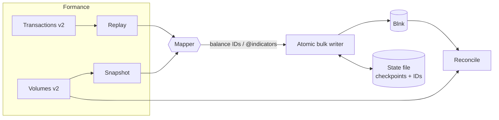

# formance2blnk

**Migrate a Formance Ledger into Blnk — safely, resumably and verifiably.**

`formance2blnk` reads transactions and balances from the [Formance Ledger v2 API](https://docs.formance.com/ledger) and records them in [Blnk](https://docs.blnkfinance.com/). It ships as a single static **CLI** and as a dependency-free **Go library** you can embed in your own tooling.

<div class="grid cards" markdown>

- :material-call-split: **[Why formance2blnk](why.md)** — the fiat/crypto separation that motivated this tool.
- :material-rocket-launch: **[Getting started](getting-started.md)** — install and run your first migration in minutes.
- :material-source-branch: **[Strategies](strategies.md)** — replay, snapshot or hybrid: pick what your audit needs.
- :material-map-marker-path: **[Mapping](mapping.md)** — route Formance addresses to Blnk ledgers and indicators.
- :material-scale-balance: **[Reconciliation](reconciliation.md)** — prove the two ledgers agree before you cut over.

</div>

## Why it's safe to run

| Guarantee | How |
| --- | --- |
| **No double-posting** | Every Blnk transaction has a deterministic reference (`fm:<ledger>:<txid>:<posting>`, or `fm-open:<ledger>:<address>:<asset>` for opening balances). Blnk rejects duplicates, and the migrator treats a duplicate as "already done". |
| **Resumable** | The last fully written Formance transaction is checkpointed in a locked state file. Ctrl-C, a crash or a deploy — just run the same command again. |
| **Atomic transactions** | All postings of a Formance transaction are written in one atomic Blnk bulk call (as long as they fit in `batch_size`, max 50). |
| **Exact amounts** | Amounts are arbitrary-precision integers from end to end; never floats. |
| **Ordered** | Transactions are applied strictly in Formance ID order, with `skip_queue` so Blnk applies them synchronously. |
| **Verifiable** | `reconcile` compares every balance — and optionally credit/debit volumes — and exits with code 2 on any difference. |

## How it works



## At a glance

```bash
formance2blnk init > formance2blnk.json   # write a starter config
formance2blnk plan                         # dry run
formance2blnk migrate                      # run (resumable)
formance2blnk reconcile -volumes           # verify
```

!!! note "Not affiliated"
    formance2blnk is an independent open-source project, released under the MIT license. It is not affiliated with Formance or Blnk Finance.
