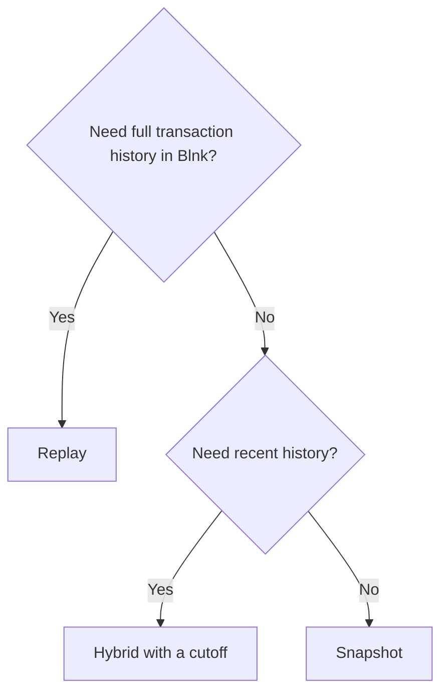

# Strategies

Choose a strategy with `migration.mode` (or `-mode` on the command line).

| | Replay | Snapshot | Hybrid |
| --- | --- | --- | --- |
| Transaction history in Blnk | Full | None | After the cutoff |
| Blnk transactions written | One per posting | One per non-zero (account, asset) | Both |
| Speed | Slowest | Fastest | In between |
| Credit/debit volumes match Formance | Yes | No | No |
| Net balances match Formance | Yes | Yes | Yes |
| Incremental catch-up | Yes | — | Yes |
| Typical use | Regulated / audit-heavy | Fresh start | Long history, recent detail |

## Replay

```json
{ "migration": { "mode": "replay" } }
```

Every Formance transaction is re-recorded in Blnk in ID order with its original timestamp as `effective_date`. Blnk ends up with the same history, the same balances and the same credit/debit volumes as Formance (verify with `reconcile -volumes`).

Replay is **incremental**: running it again only processes transactions created since the last checkpoint. That makes it ideal for a near-zero-downtime cutover — migrate while Formance is live, then run one short catch-up after freezing writes.

### Reverts

Formance reverts a transaction by recording a new transaction with the opposite postings and the metadata key `com.formance.spec/state/reverts`; the original is flagged `reverted`.

- `reverts: replay` (default) — both the original and the revert are replayed. History mirrors Formance exactly.
- `reverts: skip` — reverted transactions and their reverts are both dropped. Net balances still match; credit/debit volumes will not.

With `reverts: skip`, a transaction is dropped only if it is already reverted when the migrator reads it, and the migrator records each one it drops in the state file. A revert is dropped only if its original was. If the original was migrated before it was reverted, for example in an earlier run followed by an incremental catch-up, the revert is replayed so Blnk stays in balance. A revert that is itself reverted is handled the same way.

## Snapshot

```json
{ "migration": { "mode": "snapshot" } }
```

For each Formance ledger, the migrator reads volumes for every (account, asset) and writes one **opening-balance** transaction per non-zero balance:

- positive balance: `@World → balance`
- negative balance: `balance → @World`

Opening balances are dated at the time of the run. The counter-party is the mapped `world` indicator by default, which makes the Blnk `@World` balance equal to Formance's `world` account. Use `opening_indicator` to use a dedicated equity balance (e.g. `@OpeningBalances`) instead.

The `world` account itself is skipped (it is the counter-party). An account mapped to `skip` that holds a non-zero balance aborts the snapshot unless `on_skipped_account` is `drop`. Set `include_zero_balances: true` to also create Blnk balances for accounts (mapped to a balance, not an indicator) whose balance is zero, so every such account exists in Blnk.

Each completed ledger is marked in the state file; running the snapshot again skips it. An interrupted snapshot is simply re-run: opening balances already written are recognised by their deterministic reference.

## Hybrid

```json
{ "migration": { "mode": "hybrid", "cutoff": "2026-01-01T00:00:00Z" } }
```

1. **Snapshot as of the cutoff** — balances from transactions effective strictly *before* `cutoff` (Formance volumes with `endTime`).
2. **Replay from the cutoff** — every transaction effective *at or after* `cutoff`, in ID order. Earlier transactions are still read from Formance but skipped (`before_cutoff`).

Opening balances are dated at the cutoff, so Blnk's history begins there. With `reverts: skip`, a revert of a pre-cutoff transaction is still replayed, because the original is inside the snapshot and was never dropped.

!!! info "Cutoff semantics"
    The cutoff applies to the **effective** timestamp, which is what Formance volumes use with `endTime`. Backdated transactions inserted after the cutoff but effective before it are part of the snapshot only if they exist when the snapshot runs; ones inserted later are skipped by the replay (`before_cutoff`) and show up as drift. Always finish with a reconciliation.

    The cutoff must not be in the future, and it is recorded in the state file once the snapshot completes: re-running with a different cutoff against the same state file is refused, because it would double-count or drop the transactions between the two cutoffs.

## Choosing


